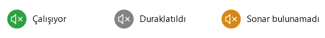
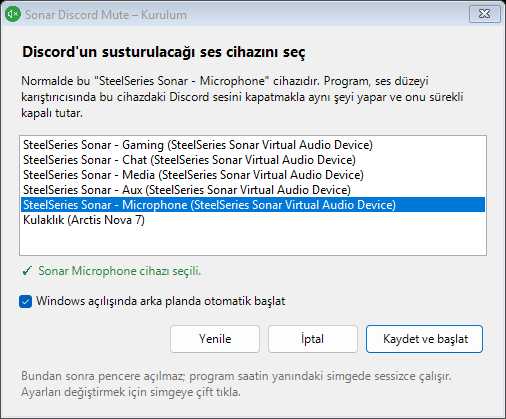
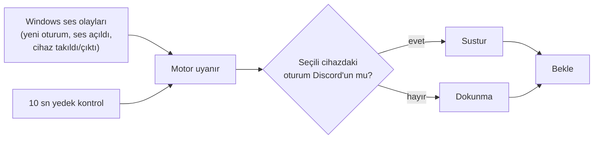

<div align="center">



# Sonar Discord Mute

**SteelSeries Sonar + Discord ekran paylaşımındaki yankı sorununu kalıcı olarak çözen,
arka planda sessizce çalışan küçük bir Windows aracı.**

[](https://github.com/Yagzk/sonar-discord-mute/releases/latest)


### [⬇ İndir (SonarDiscordMute.zip)](https://github.com/Yagzk/sonar-discord-mute/releases/latest/download/SonarDiscordMute.zip)

</div>

---

## Sorun

SteelSeries Sonar kullanırken Discord'da **sesli ekran paylaşımı** yapınca izleyenler yankı duyuyor.
Bilinen çözüm, Windows'un **ses düzeyi karıştırıcısında** `SteelSeries Sonar - Microphone`
cihazında Discord'un sesini kapatmak. Ama bu ayar zamanla geri açılabiliyor ve her seferinde
elle kapatmak gerekiyor.

## Çözüm

Sonar Discord Mute bu işi senin yerine yapar: seçtiğin cihazda Discord'un sesini kapatır
ve **sürekli kapalı tutar**.

- 🔇 Discord o cihazda yeni bir ses oturumu açtığı anda susturur
- ↩️ Biri karıştırıcıdan sesi geri açarsa milisaniyeler içinde tekrar kapatır
- 🔌 Sonar kapanıp açılınca cihazı kendisi tekrar bulur
- 🪶 Windows ile arka planda başlar, pencere açmaz, kaynak harcamaz
- 🎮 Oyunlara dokunmaz ([ayrıntılar](#güvenli-mi-anti-cheat-vac--vanguard))

## Kurulum

1. **[SonarDiscordMute.zip](https://github.com/Yagzk/sonar-discord-mute/releases/latest/download/SonarDiscordMute.zip)**'i indir,
   içindeki `SonarDiscordMute.exe`'yi kalıcı bir klasöre koy (ör. `Belgeler\SonarDiscordMute`).
2. SteelSeries GG (Sonar) açıkken exe'ye çift tıkla.
   - *"Windows bilgisayarınızı korudu"* uyarısı çıkarsa: **Ek bilgi → Yine de çalıştır**
     (exe imzasız olduğu için çıkar).
3. `SteelSeries Sonar - Microphone` kendiliğinden seçili gelir → **Kaydet ve başlat**. Bu kadar.

<p align="center"></p>

Bundan sonra pencere bir daha açılmaz. Program Windows açılınca kendiliğinden başlar.

## Kullanım

Saatin yanında küçük bir simge olur (görünmüyorsa `^` okuna tıkla). Rengi durumu gösterir:

| Simge | Anlamı |
|---|---|
| 🟢 Yeşil | Çalışıyor, Discord susturuluyor |
| ⚪ Gri | Duraklatıldı, Discord sesi açık |
| 🟠 Turuncu | Sonar cihazı bulunamadı (SteelSeries GG kapalı olabilir) |

Simgeye **sağ tıkla**:

<p align="center"></p>

- **Duraklat**: Discord'un sesini geri açar, tekrar tıklayınca devam eder.
- **Cihazı değiştir**: Kurulum penceresini açar (simgeye ya da exe'ye çift tıklamak da açar).
- **Windows açılışında başlat**: Otomatik başlatmayı açar/kapatır.
- **Çıkış**: Discord'un o cihazdaki sesini geri açar ve programı kapatır.

> Bilgisayar kapanırken Discord o cihazda susturulmuş kalır; Windows bu ayarı hatırlar.
> Sesi sadece menüden **Çıkış** deyince geri açılır.

## Güncelleme

Yeni sürümün exe'sine **çift tıklaman yeterli**. Çalışan eski sürümü kendisi kapatır ve yerini alır:

- Ayarların korunur, kurulum penceresi tekrar açılmaz.
- Geçiş sırasında Discord susturulmuş kalır.
- Yeni exe'yi başka bir klasöre koyduysan otomatik başlatma kaydı oraya güncellenir;
  eski exe'yi silebilirsin.

v1.0.0'dan güncelleme de böyle yapılır.

## Kaynak kullanımı

Program sürekli tarama yapmaz; Windows'un ses olaylarını dinler ve sadece bir şey
değiştiğinde birkaç milisaniye çalışır.

| | Ölçülen |
|---|---|
| İşlemci (boşta) | 30 saniyede ölçülemeyecek kadar az (≈ %0) |
| Bellek (Görev Yöneticisi) | ≈ 2 MB |
| Susturma tepkisi | ≈ 15 ms |
| Exe boyutu | ≈ 40 KB |
| Gereksinim | Windows 10/11 (.NET Framework 4.x zaten yüklü gelir) |

## Güvenli mi? Anti-cheat (VAC / Vanguard)

Program anti-cheat sistemlerinin aradığı türden hiçbir şey yapmaz:

- ❌ Oyunların belleğini okumaz/yazmaz, kod enjekte etmez, sürücü (driver) kurmaz, hook kullanmaz.
- ✅ Sadece Windows'un ses karıştırıcısının da kullandığı resmi **Core Audio API** ile tek bir
  cihazdaki Discord ses oturumunu susturur.
- ✅ Oturumun hangi uygulamaya ait olduğunu Windows'un ses oturumu bilgisinden okur;
  normalde oyun dahil hiçbir programın sürecine erişmez.
- ✅ İnternete bağlanmaz, veri toplamaz. Değiştirdiği tek sistem ayarı isteğe bağlı otomatik başlatma kaydıdır
  (`HKCU\Software\Microsoft\Windows\CurrentVersion\Run`).
- ✅ Kaynak kodu tek bir dosya ([`SonarDiscordMute.cs`](SonarDiscordMute.cs)); okuyabilir ve kendin derleyebilirsin.

## Nasıl çalışır?



<details>
<summary>Teknik ayrıntılar</summary>

- Seçilen çıkış cihazında `IAudioSessionManager2` açılır, Discord oturumları `ISimpleAudioVolume::SetMute` ile susturulur.
- `IAudioSessionNotification` yeni oturumları, `IAudioSessionEvents` ses/susturma değişikliklerini,
  `IMMNotificationClient` cihaz takılıp çıkmalarını bildirir. Programın kendi değişiklikleri
  `EventContext` GUID'i ile ayırt edilir, böylece döngüye girmez.
- Bütün COM işleri tek bir MTA thread'inde yapılır; bildirimler sadece bu thread'i uyandırır.
- Exe adı oturum kimliğinden (`...|\Device\...\Discord.exe%b{...}`) okunur. Klasör veya kullanıcı adı
  eşleşmesin diye sadece dosya adına bakılır.
- Cihaz kimliği değişirse (ör. Sonar yeniden kurulursa) aynı isimli cihaz bulunur.
- Tek kopya çalışır. Daha yeni bir sürüm açılırsa eskisi kapanıp yerini ona bırakır.

</details>

## Ayarlar

Ayarlar `%APPDATA%\SonarDiscordMute\ayarlar.ini` dosyasında tutulur:

| Anahtar | Açıklama |
|---|---|
| `cihaz_id` | Seçilen ses cihazının Windows kimliği |
| `cihaz_adi` | Cihazın adı (kimlik değişirse bununla bulunur) |
| `uygulama` | Adında bu kelime geçen programlar susturulur (varsayılan: `discord`; PTB/Canary de dahil) |

## Kaynaktan derleme

Visual Studio gerekmez. Windows'ta hazır gelen .NET Framework derleyicisi yeterli:

```bat
build.bat
```

Çıktı: `SonarDiscordMute.exe`

## Kaldırma

1. Simgeye sağ tıkla → **Windows açılışında başlat** işaretini kaldır → **Çıkış**.
2. Exe'yi ve `%APPDATA%\SonarDiscordMute` klasörünü sil.

## Sorun giderme

| Durum | Çözüm |
|---|---|
| Simge turuncu | SteelSeries GG'yi aç. Düzelmezse simgeye çift tıkla ve cihazı tekrar seç. |
| Menüde "şu an bu cihazda Discord sesi yok" yazıyor | Normal. Discord o cihazda ses açtığı anda susturulur. |
| Yankı hâlâ var | Simgeye çift tıkla ve doğru cihazın (`Sonar - Microphone`) seçili olduğunu kontrol et. |
| Kendi duyduğum Discord sesi | Sadece seçili cihazdaki Discord oturumu kapatılır; diğer cihazlara (ör. `Sonar - Chat`) dokunulmaz. |

---

<details>
<summary>🇬🇧 English</summary>

**Sonar Discord Mute** is a tiny Windows tray app that fixes the echo heard by viewers when you
screen-share with audio on Discord while using SteelSeries Sonar. The known manual fix is muting Discord
on the `SteelSeries Sonar - Microphone` device in the Windows volume mixer. This app does that for you
and keeps it muted: it listens to Windows Core Audio events (new sessions, unmutes, device changes) and
re-mutes within milliseconds, idling at ~0% CPU and ~2 MB RAM. It never touches game processes
(no memory access, injection, drivers or hooks) and makes no network connections.

Download the latest release, run the exe, confirm the auto-selected Sonar Microphone device, done.
To update, just run the newer exe; it takes over from the running old version.

</details>
