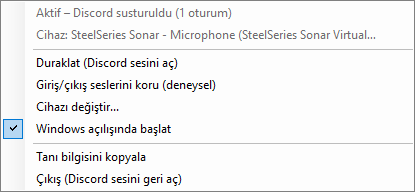
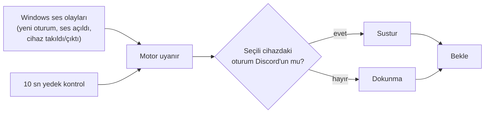

<div align="center">


# Sonar Discord Mute

**SteelSeries Sonar + Discord ekran paylaşımındaki yankı sorununu kalıcı olarak çözen,
arka planda sessizce çalışan küçük bir Windows aracı.**

*Fixes the echo your viewers hear when you screen-share with audio on Discord while using SteelSeries Sonar.*

[](https://github.com/Yagzk/sonar-discord-mute/releases/latest)


[](LICENSE)

### [⬇ İndir (SonarDiscordMute.zip)](https://github.com/Yagzk/sonar-discord-mute/releases/latest/download/SonarDiscordMute.zip)

</div>

---

## Bu sorunu yaşıyor musun?

- [x] Bilgisayarında **SteelSeries GG / Sonar** açık (SteelSeries kulaklık kullananlarda genelde öyle).
- [x] Discord'da **sesi açık şekilde ekran paylaşıyorsun** ya da yayın (Go Live) yapıyorsun.
- [x] Yayını izleyenler **yankı duyduklarını**, kendi seslerinin ve sohbetin yayından
      **ikinci kez, gecikmeli** geldiğini söylüyor.

Üçü de tutuyorsa bu program tam olarak bunun için.

## Sorun

Sonar, bilgisayardaki bütün sesleri kendi sanal ses cihazlarından geçirir:
`Sonar - Gaming`, `Sonar - Chat`, `Sonar - Media`, `Sonar - Microphone`...
Discord'un sesi `SteelSeries Sonar - Microphone` cihazına da gidiyor ve oradan
senin ekran paylaşımına karışıyor. Sonuçta:

```
Arkadaşın konuşur ──► Discord sana çalar ──► ses "Sonar - Microphone"a da düşer
        ▲                                                   │
        └──────────── yayınından geri duyar ◄───────────────┘   (yankı)
```

Sen bir şey fark etmezsin, ama yayını izleyen herkes konuşmaları iki kez duyar.

## Elle çözüm (ve neden yetmiyor)

Bilinen geçici çözüm şu:

1. Görev çubuğundaki ses simgesine sağ tıkla → **Ses düzeyi karıştırıcısını aç**.
2. Cihaz olarak `SteelSeries Sonar - Microphone`'u seç.
3. Oradaki **Discord**'un sesini kapat.

Bu yankıyı hemen keser. Ama ayar kalıcı değil: Discord yeni bir ses oturumu açtığında ya da
yeniden başladığında ses geri açılabiliyor. O zaman her yayından önce karıştırıcıya girip
tekrar kapatman gerekiyor.

## Çözüm

Sonar Discord Mute bu adımı senin yerine yapar: `SteelSeries Sonar - Microphone` cihazında
Discord'un sesini kapatır ve **sürekli kapalı tutar**.

- 🔇 Discord o cihazda yeni bir ses oturumu açtığı anda susturur
- ↩️ Biri karıştırıcıdan sesi geri açarsa milisaniyeler içinde tekrar kapatır
- 🔌 Sonar kapanıp açılınca cihazı kendisi tekrar bulur
- 🪶 Windows ile arka planda başlar, pencere açmaz, kaynak harcamaz
- 🎮 Oyunlara dokunmaz ([ayrıntılar](#güvenli-mi-anti-cheat-vac--vanguard))

## Kurulum

1. **[SonarDiscordMute.zip](https://github.com/Yagzk/sonar-discord-mute/releases/latest/download/SonarDiscordMute.zip)**'i indir,
   içindeki `SonarDiscordMute.exe`'yi kalıcı bir klasöre koy (ör. `Belgeler\SonarDiscordMute`).
2. SteelSeries GG (Sonar) açıkken exe'ye çift tıkla.
   - *"Windows bilgisayarınızı korudu"* uyarısı çıkarsa: **Ek bilgi → Yine de çalıştır**
     (exe imzasız olduğu için çıkar).
3. `SteelSeries Sonar - Microphone` kendiliğinden seçili gelir → **Kaydet ve başlat**. Bu kadar.

<p align="center"></p>

Bundan sonra pencere bir daha açılmaz. Program Windows açılınca kendiliğinden başlar.

## Kullanım

Saatin yanında küçük bir simge olur (görünmüyorsa `^` okuna tıkla). Rengi durumu gösterir:

| Simge | Anlamı |
|---|---|
| 🟢 Yeşil | Çalışıyor, Discord susturuluyor |
| ⚪ Gri | Duraklatıldı, Discord sesi açık |
| 🟠 Turuncu | Sonar cihazı bulunamadı (SteelSeries GG kapalı olabilir) |

Simgeye **sağ tıkla**:

<p align="center"></p>

- **Duraklat**: Discord'un sesini geri açar, tekrar tıklayınca devam eder.
- **Giriş/çıkış seslerini koru (deneysel)**: Discord'un giriş/çıkış ve bildirim seslerini susturmaz
  ([aşağıya bak](#girişçıkış-sesleri-duyulmuyorsa)).
- **Cihazı değiştir**: Kurulum penceresini açar (simgeye ya da exe'ye çift tıklamak da açar).
- **Windows açılışında başlat**: Otomatik başlatmayı açar/kapatır.
- **Tanı bilgisini kopyala**: Discord'un hangi ses oturumunun hangi cihazda olduğunu panoya kopyalar.
- **Çıkış**: Discord'un o cihazdaki sesini geri açar ve programı kapatır.

> Bilgisayar kapanırken Discord o cihazda susturulmuş kalır; Windows bu ayarı hatırlar.
> Sesi sadece menüden **Çıkış** deyince geri açılır.

## Giriş/çıkış sesleri duyulmuyorsa

Windows tek tek sesleri değil, bir uygulamanın **ses oturumunu** susturabilir. Discord ise
seslerini iki ayrı iç süreçten çalar:

| Discord süreci | Ne çalar |
|---|---|
| Ses motoru | Kanaldaki konuşmalar |
| Chromium ses servisi | Giriş/çıkış, bildirim gibi arayüz sesleri |

Discord'un arayüz sesleri de `Sonar - Microphone` cihazına gidiyorsa, varsayılan ayar
(ve karıştırıcıdan elle susturmak) onları da kapatır; giriş/çıkış seslerini duymazsın.

**Çözüm:** Simgeye sağ tıkla → **Giriş/çıkış seslerini koru (deneysel)**. Program artık arayüz seslerini
susturmaz, sadece diğerlerini susturur. Sonra sesli bir ekran paylaşımı yapıp izleyene yankı olup olmadığını sor:

- **Yankı yok, giriş/çıkış sesleri geliyor:** Tamam, böyle kalsın.
- **Yankı geri geldi:** Seçeneği kapat. Demek ki yankı, arayüz sesleriyle aynı Discord oturumundan geliyor.
  Simgeye sağ tıkla → **Tanı bilgisini kopyala** ve çıkan metni
  [issue olarak](https://github.com/Yagzk/sonar-discord-mute/issues/new) paylaş; oturumların nerede olduğunu gösterir.

## Güncelleme

Yeni sürümün exe'sine **çift tıklaman yeterli**. Çalışan eski sürümü kendisi kapatır ve yerini alır:

- Ayarların korunur, kurulum penceresi tekrar açılmaz.
- Geçiş sırasında Discord susturulmuş kalır.
- Yeni exe'yi başka bir klasöre koyduysan otomatik başlatma kaydı oraya güncellenir;
  eski exe'yi silebilirsin.

v1.0.0'dan güncelleme de böyle yapılır.

## Kaynak kullanımı

Program sürekli tarama yapmaz; Windows'un ses olaylarını dinler ve sadece bir şey
değiştiğinde birkaç milisaniye çalışır.

| | Ölçülen |
|---|---|
| İşlemci (boşta) | 30 saniyede ölçülemeyecek kadar az (≈ %0) |
| Bellek (Görev Yöneticisi) | ≈ 2 MB |
| Susturma tepkisi | ≈ 15 ms |
| Exe boyutu | ≈ 40 KB |
| Gereksinim | Windows 10/11 (.NET Framework 4.x zaten yüklü gelir) |

## Güvenli mi? Anti-cheat (VAC / Vanguard)

Program anti-cheat sistemlerinin aradığı türden hiçbir şey yapmaz:

- ❌ Oyunların belleğini okumaz/yazmaz, kod enjekte etmez, sürücü (driver) kurmaz, hook kullanmaz.
- ✅ Sadece Windows'un ses karıştırıcısının da kullandığı resmi **Core Audio API** ile tek bir
  cihazdaki Discord ses oturumunu susturur.
- ✅ Oturumun hangi uygulamaya ait olduğunu Windows'un ses oturumu bilgisinden okur;
  oyun dahil başka hiçbir programın sürecine erişmez. Sadece "Giriş/çıkış seslerini koru" açıkken
  ve tanı bilgisinde, Discord'un kendi süreçlerinin türüne bakar.
- ✅ İnternete bağlanmaz, veri toplamaz. Değiştirdiği tek sistem ayarı isteğe bağlı otomatik başlatma kaydıdır
  (`HKCU\Software\Microsoft\Windows\CurrentVersion\Run`).
- ✅ Kaynak kodu tek bir dosya ([`SonarDiscordMute.cs`](SonarDiscordMute.cs)); okuyabilir ve kendin derleyebilirsin.

## Nasıl çalışır?



<details>
<summary>Teknik ayrıntılar</summary>

- Seçilen çıkış cihazında `IAudioSessionManager2` açılır, Discord oturumları `ISimpleAudioVolume::SetMute` ile susturulur.
- `IAudioSessionNotification` yeni oturumları, `IAudioSessionEvents` ses/susturma değişikliklerini,
  `IMMNotificationClient` cihaz takılıp çıkmalarını bildirir. Programın kendi değişiklikleri
  `EventContext` GUID'i ile ayırt edilir, böylece döngüye girmez.
- Bütün COM işleri tek bir MTA thread'inde yapılır; bildirimler sadece bu thread'i uyandırır.
- Exe adı oturum kimliğinden (`...|\Device\...\Discord.exe%b{...}`) okunur. Klasör veya kullanıcı adı
  eşleşmesin diye sadece dosya adına bakılır.
- Discord oturumunun rolü süreç komut satırından anlaşılır: `--type=renderer` ses motoru,
  `audio.mojom.AudioService` arayüz sesleri. Bu sadece Discord süreçleri için yapılır.
- Cihaz kimliği değişirse (ör. Sonar yeniden kurulursa) aynı isimli cihaz bulunur.
- Tek kopya çalışır. Daha yeni bir sürüm açılırsa eskisi kapanıp yerini ona bırakır.

</details>

## Ayarlar

Ayarlar `%APPDATA%\SonarDiscordMute\ayarlar.ini` dosyasında tutulur:

| Anahtar | Açıklama |
|---|---|
| `cihaz_id` | Seçilen ses cihazının Windows kimliği |
| `cihaz_adi` | Cihazın adı (kimlik değişirse bununla bulunur) |
| `uygulama` | Adında bu kelime geçen programlar susturulur (varsayılan: `discord`; PTB/Canary de dahil) |
| `arayuz_seslerini_koru` | `1` ise Discord'un giriş/çıkış ve bildirim seslerini susturmaz (menüdeki seçenek) |

## Kaynaktan derleme

Visual Studio gerekmez. Windows'ta hazır gelen .NET Framework derleyicisi yeterli:

```bat
build.bat
```

Çıktı: `SonarDiscordMute.exe`

## Kaldırma

1. Simgeye sağ tıkla → **Windows açılışında başlat** işaretini kaldır → **Çıkış**.
2. Exe'yi ve `%APPDATA%\SonarDiscordMute` klasörünü sil.

## Sorun giderme

| Durum | Çözüm |
|---|---|
| Simge turuncu | SteelSeries GG'yi aç. Düzelmezse simgeye çift tıkla ve cihazı tekrar seç. |
| Menüde "şu an bu cihazda Discord sesi yok" yazıyor | Normal. Discord o cihazda ses açtığı anda susturulur. |
| Yankı hâlâ var | Simgeye çift tıkla ve doğru cihazın (`Sonar - Microphone`) seçili olduğunu kontrol et. "Giriş/çıkış seslerini koru" açıksa kapat. |
| Giriş/çıkış seslerini duymuyorum | Simgeye sağ tıkla → **Giriş/çıkış seslerini koru (deneysel)**. |
| Kendi duyduğum Discord sesi | Sadece seçili cihazdaki Discord oturumu kapatılır; diğer cihazlara (ör. `Sonar - Chat`) dokunulmaz. |

## Lisans

[MIT](LICENSE). Kullanabilir, değiştirebilir ve paylaşabilirsin; lisans metnini korumak yeterli.

SteelSeries, Sonar ve Discord kendi sahiplerinin markalarıdır. Bu proje onlarla bağlantılı değildir.

---

<details>
<summary>🇬🇧 English</summary>

**The problem:** with SteelSeries Sonar (SteelSeries GG) running, screen-sharing or going live on Discord
*with audio* makes your viewers hear an echo. Their own voices and the call come back to them a second time,
delayed, through your stream. Discord's audio also ends up on the `SteelSeries Sonar - Microphone`
virtual device and leaks back into the stream.

**The manual fix:** open the Windows volume mixer, pick the `SteelSeries Sonar - Microphone` device and
mute Discord there. It works, but the setting doesn't stick: Discord can come back unmuted when it opens
a new audio session or restarts.

**What this app does:** **Sonar Discord Mute** is a tiny Windows tray app that applies that fix for you
and keeps it applied. It listens to Windows Core Audio events (new sessions, unmutes, device changes) and
re-mutes within milliseconds, idling at ~0% CPU and ~2 MB RAM. It never touches game processes
(no memory access, injection, drivers or hooks) and makes no network connections.

Muting works per audio session, and Discord plays call audio (voice engine) and UI sounds such as
join/leave (Chromium audio service) from separate processes. If you lose the join/leave sounds, enable
**"Giriş/çıkış seslerini koru"** (keep join/leave sounds) in the tray menu to leave the UI-sound session unmuted.

Download the latest release, run the exe, confirm the auto-selected Sonar Microphone device, done.
To update, just run the newer exe; it takes over from the running old version.

MIT licensed. Not affiliated with SteelSeries or Discord.

</details>
